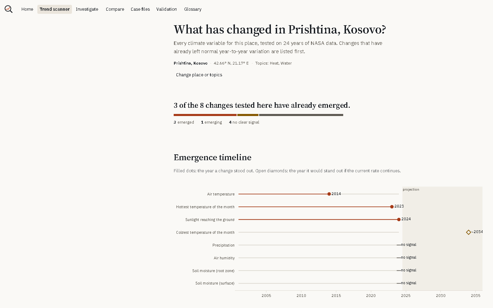
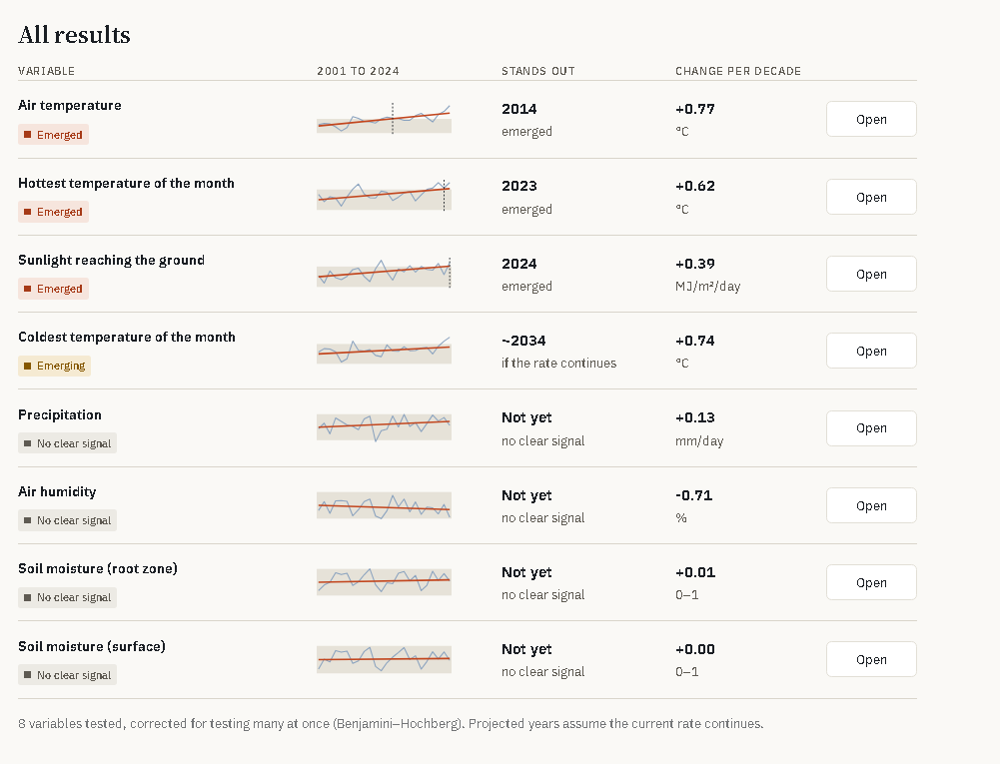
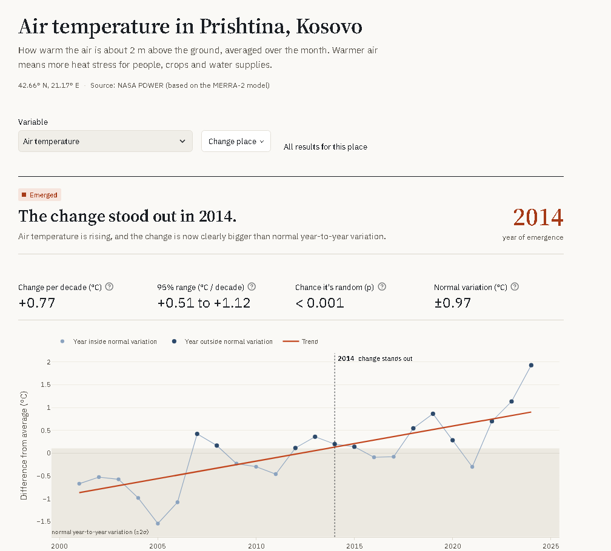
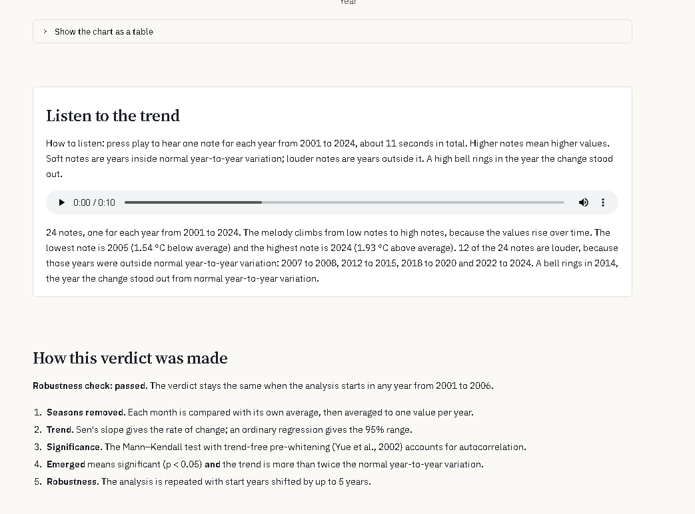
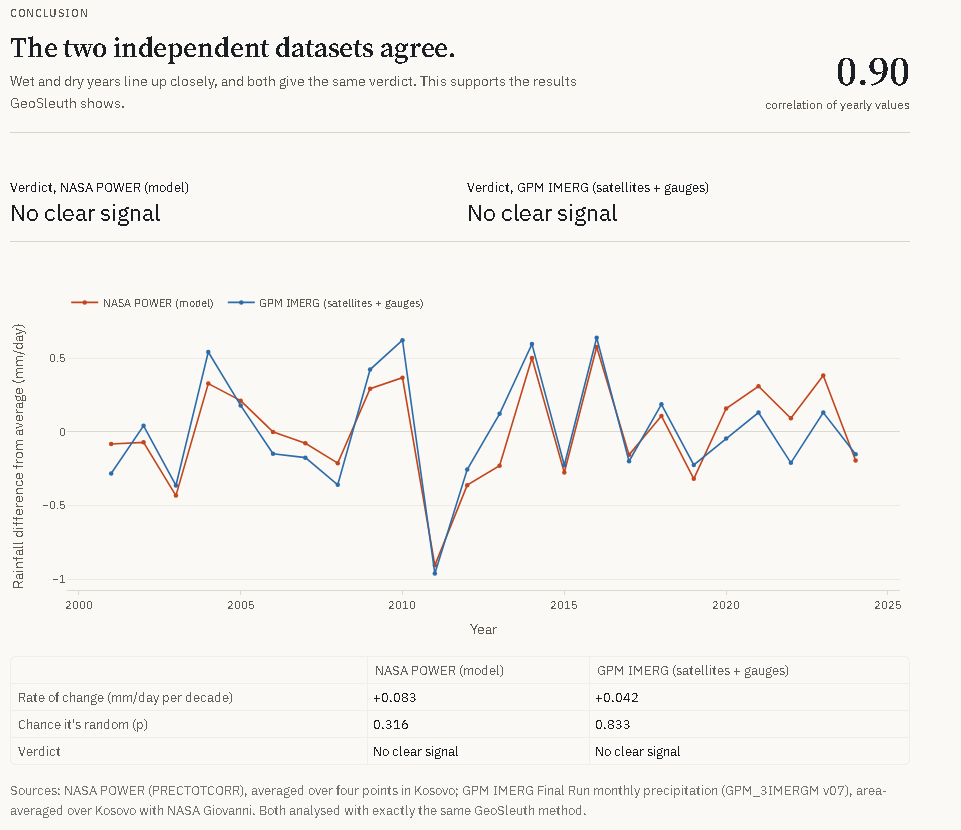
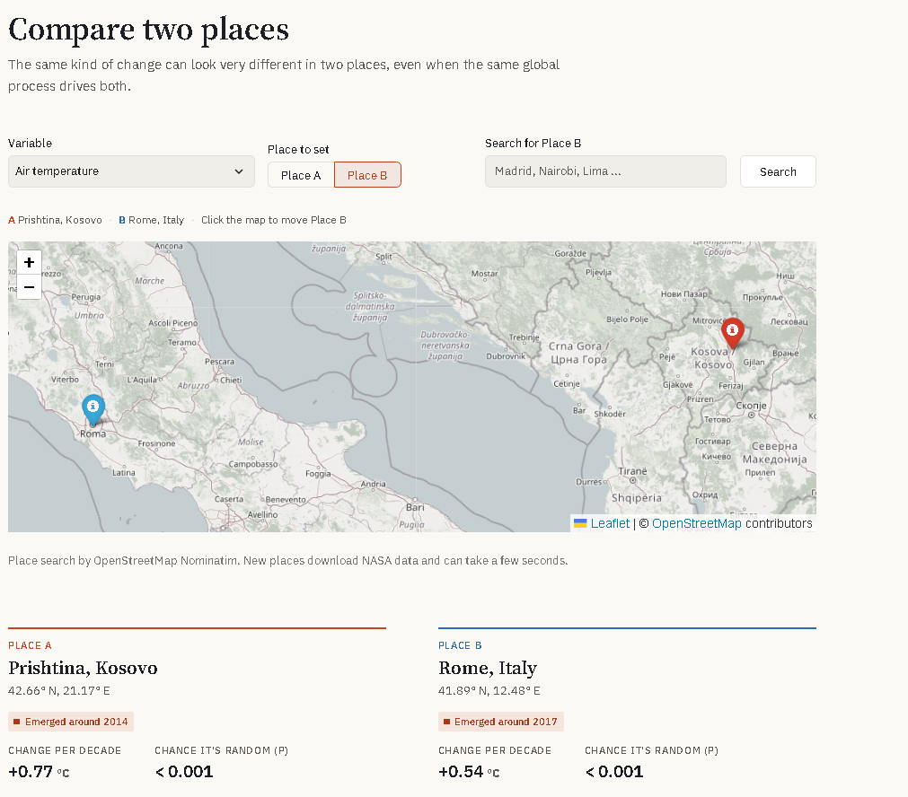
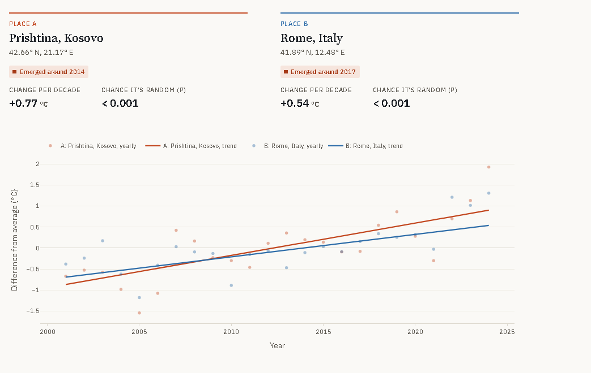

# GeoSleuth

**When does climate change become undeniable where you live?**

GeoSleuth is a web app that scans 24 years of NASA data for any place on Earth and shows which changes have already stood out from normal year-to-year variation, when they did, and which are still hidden in the noise. Every result comes with a chart, a rate of change, a significance test, a robustness check and a sound you can listen to.

**Live app:** https://geosleuth.streamlit.app/

Built for the **NASA Space Apps Challenge 2026**, challenge **"Be an Earth System Trend Detective!"**, Tirana local event.

> If the app shows a sleep screen, click "Yes, get this app back up" and wait about a minute.

---

## The challenge

Build a tool that lets people select Earth science variables measured by NASA missions or produced by NASA models, visualize how they change over time for a region, and determine what is changing, where, how much, and whether the change is statistically significant. The intended audience is high school and college students and members of the public with some science background.

## How GeoSleuth answers it

| Challenge objective | Where in GeoSleuth |
| --- | --- |
| Identify variables that could show a trend | A catalog of 9 NASA variables in plain language (heat, water, air), and a Trend scanner that tests all of them for a place at once |
| Acquire the data for a region | Any place on Earth by map click or city search; NASA POWER data is downloaded and cached automatically |
| Generate and visualize a time series | Yearly values with the seasonal cycle removed, the trend line, and a band showing normal year-to-year variation |
| Rate of change and significance | Sen's slope per decade, Mann–Kendall test with autocorrelation correction, OLS t-test and 95% confidence interval |

It also includes the extras the challenge suggests: simple definitions for every variable and term, guided questions to start an investigation, and ready-made demonstration cases.

## What makes it different

- **Time of emergence.** GeoSleuth does not stop at "significant or not". It finds the year a change became larger than twice the natural year-to-year variation, and for changes still hidden in the noise, estimates when they would stand out if the current rate continues.
- **Honest statistics.** Seasons are removed first, autocorrelation is corrected for, results are corrected for testing many variables at once, and every verdict is re-checked with different start years.
- **Validated.** Our pipeline was checked against an independent NASA satellite record (see Validation below).
- **Accessible.** Every trend can be played as a short melody, with a bell at the emergence year and a full text description for screen readers, and every chart can be shown as a table.

## Pages

| Page | What it does |
| --- | --- |
| Home | Pick a place (map, quick picks) and topics, then start an investigation |
| Trend scanner | Every variable for the place on an emergence timeline, ranked Emerged, Emerging or No clear signal |
| Investigate | One variable in depth: chart, natural-variation band, emergence year, verdict, rate, 95% range, p-value, robustness check, Listen to the trend, and the chart as a table |
| Compare | Any two places in the world, side by side, with an honest note on whether their trends really differ |
| Case files | Ready-made investigations, calculated live |
| Validation | NASA POWER rainfall compared with the independent GPM IMERG satellite record for Kosovo |
| Glossary | Plain-language explanations of every term |

### Trend scanner





### Investigate





## Method

1. **Data:** monthly values for 2001–2024 from NASA POWER for the chosen point.
2. **Remove the seasonal cycle:** subtract each calendar month's average, then average to one anomaly per year (years with at least 10 months of data).
3. **Rate of change:** Sen's slope (Sen, 1968), reported per decade; OLS slope with t-test and 95% confidence interval alongside.
4. **Significance:** Mann–Kendall test (Mann, 1945; Kendall, 1975) with trend-free pre-whitening to account for autocorrelation (Yue et al., 2002). If the corrected test cannot be computed, the original test is used.
5. **Natural variation (σ):** standard deviation of the yearly values around the trend.
6. **Emergence:** signal-to-noise = |slope × years since 2001| / σ.
   - **Emerged:** p < 0.05 and signal-to-noise reaches 2; the emergence year is the first year it does.
   - **Emerging:** not yet emerged, p < 0.20; projected year = 2001 + 2σ / |slope|, shown only if before 2060 and always labelled as an estimate.
   - **No clear signal:** everything else.
7. **Many variables at once:** Benjamini–Hochberg false-discovery-rate correction (Benjamini and Hochberg, 1995) in the Trend scanner; a weak "emerged" result is downgraded to "emerging".
8. **Robustness:** the analysis is repeated with start years 2002 to 2006; the check passes if the verdict never changes.

**Limitations:** trends are linear by design, as the challenge recommends; NASA POWER provides point values from global models and satellite products, not local station measurements; 24 years is enough to detect strong trends, but weak trends may need more years of data; projected emergence years assume the current rate continues.

## Validation

We compared NASA POWER rainfall (a weather model) averaged over four points in Kosovo with GPM IMERG (an independent record built from satellites and rain gauges), area-averaged over Kosovo with NASA Giovanni, for 2001–2024. Both were analysed with exactly the same GeoSleuth method.

| | NASA POWER | GPM IMERG |
| --- | --- | --- |
| Rate of change (mm/day per decade) | +0.083 | +0.042 |
| Chance it's random (p) | 0.316 | 0.833 |
| Verdict | No clear signal | No clear signal |

**Correlation between the yearly values: 0.90.** The two independent datasets agree closely on wet and dry years and give the same verdict.



## Example findings

| Finding | Result |
| --- | --- |
| Prishtina, air temperature | +0.77 °C per decade (95% range +0.51 to +1.12), emerged in 2014, p < 0.001, robustness check passed |
| Prishtina, hottest temperature of the month | Emerged in 2023: extremes vary more from year to year, so their change takes longer to stand out |
| Prishtina, coldest temperature of the month | Emerging: likely to stand out around 2034 if the current rate continues |
| Rome vs Prishtina, air temperature | +0.54 vs +0.77 °C per decade; emerged in 2017 vs 2014 |





## Data sources

| Source | What we use | Link |
| --- | --- | --- |
| NASA POWER | Monthly point data 2001–2024: T2M, T2M_MAX, T2M_MIN, PRECTOTCORR, RH2M, GWETROOT, GWETTOP, WS2M, ALLSKY_SFC_SW_DWN | https://power.larc.nasa.gov/ |
| MERRA-2 | The NASA model most NASA POWER meteorology variables are based on | https://gmao.gsfc.nasa.gov/reanalysis/MERRA-2/ |
| CERES | The satellite source of the sunlight variable | https://ceres.larc.nasa.gov/ |
| GPM IMERG (GPM_3IMERGM v07) | Monthly Final Run precipitation, used for validation | https://gpm.nasa.gov/data/imerg |
| NASA Giovanni | Area-averaged GPM IMERG time series for Kosovo | https://giovanni.gsfc.nasa.gov/ |
| OpenStreetMap Nominatim | Place search and place names | https://nominatim.openstreetmap.org/ |

Note: in NASA POWER's monthly data, T2M_MAX and T2M_MIN are the hottest and coldest values reached in the month, not averages of daily highs and lows. GeoSleuth labels them that way.

## Run it locally

Requires Python 3.11.

```bash
git clone https://github.com/Flandrab/GeoSleuth.git
cd GeoSleuth
python -m venv venv
venv\Scripts\activate          # Windows
# source venv/bin/activate     # macOS / Linux
pip install -r requirements.txt
python -m pytest
python -m streamlit run app/Home.py
```

## Project structure

```
app/
  Home.py              entry point and navigation
  views/               the pages (Home, Trend scanner, Investigate, Compare, Case files, Glossary, Validation)
  static/              logo and icon
src/
  catalog.py           the variable catalog
  fetch_power.py       the only call to the NASA POWER API
  cache.py             Parquet cache in data/cache/
  data.py              get_series(): monthly data for a variable and place
  stats.py             analyze(): the whole statistical method
  detect.py            scan_region(): the Trend scanner
  sonify.py            sonification and text descriptions
  geocode.py           place search and names
  ui.py                shared styling and display helpers
data/
  catalog.json         9 variables with plain-language definitions
  cases.json           demonstration cases
  validation/          GPM IMERG data from Giovanni
  cache/               cached NASA downloads
docs/
  screenshots/         images used in this README
tests/                 pytest tests for statistics, sonification and the app
```

## Future work

- An AI guide that lets users ask questions in plain words and investigates for them, with every number still computed by the statistics code
- More datasets directly from NASA archives: GPM IMERG, GLDAS soil moisture, MODIS vegetation (via AppEEARS), OMI air quality
- Area averages for any region drawn on the map, not just points
- Longer records where available, and validation against weather-station data
- Non-linear trends and change-point detection

## Use of AI

We used Claude (Anthropic) as a coding and planning assistant during the hackathon. All analysis in the app is done by our own statistics code; no numbers shown in GeoSleuth are generated by AI.

## Team

- **Flandra Bytyqi**: data pipeline, statistics, emergence detection, validation, app pages
- **Delvinë Bekteshi**: sonification, back end, design and front end, presentation

## References

- Benjamini, Y., and Hochberg, Y. (1995). Controlling the false discovery rate: a practical and powerful approach to multiple testing. Journal of the Royal Statistical Society, Series B, 57(1), 289–300.
- Kendall, M. G. (1975). Rank Correlation Methods. Charles Griffin, London.
- Mann, H. B. (1945). Nonparametric tests against trend. Econometrica, 13(3), 245–259.
- Sen, P. K. (1968). Estimates of the regression coefficient based on Kendall's tau. Journal of the American Statistical Association, 63(324), 1379–1389.
- Yue, S., Pilon, P., Phinney, B., and Cavadias, G. (2002). The influence of autocorrelation on the ability to detect trend in hydrological series. Hydrological Processes, 16(9), 1807–1829.
